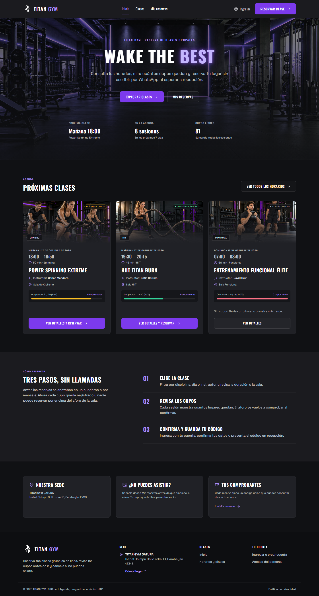

# FitSmart Agenda · TITAN GYM

Aplicación web para consultar clases, conocer los cupos disponibles y reservar en TITAN GYM. MVP académico APF2 desarrollado con React, TypeScript y Supabase: las reservas se guardan en PostgreSQL y el aforo se valida de forma atómica, incluso ante solicitudes simultáneas.



> Estado: reservas y panel de administración implementados y conectados a Supabase. Preparado para Vercel, sin despliegue público verificado. La primera cuenta administradora debe ser autorizada explícitamente; no se asignan roles automáticamente.

## Funcionalidades

- Inicio con clases destacadas obtenidas del catálogo real.
- Búsqueda y filtros por disciplina, fecha y disponibilidad.
- Detalle de sesiones con instructor, sede, horario, capacidad y ocupación.
- Reserva con validación de datos, identidad verificada y prevención de duplicados.
- Confirmación que consulta una reserva guardada; sin comprobantes ficticios.
- Mis reservas: próximas sesiones e historial exclusivos de la cuenta autenticada, con cancelación antes del inicio de la clase.
- Acceso con correo y contraseña, Google como segunda opción y enlace por correo.
- Creación de contraseña desde una cuenta ya autenticada, conservando su identidad y reservas.
- Diseño responsive para escritorio, tablet y móvil, con recursos originales de TITAN GYM.
- Panel administrativo para crear/editar clases, programar sesiones, consultar inscritos y registrar asistencia con historial.
- Indicador de no-shows y exportación CSV del dataset seudonimizado para el componente de Machine Learning (APF3).
- Comprobante con código QR y registro de llegada en recepción escaneando el QR desde el panel.
- Recordatorio por correo 3 horas antes de cada clase, con opción para desactivarlo.

## Tecnologías

| Área | Herramientas |
| --- | --- |
| Interfaz | React, TypeScript estricto, Vite, Tailwind CSS, Lucide |
| Navegación y datos | React Router, TanStack Query |
| Formularios | React Hook Form, Zod |
| Backend | Supabase Auth, PostgreSQL, Supabase JavaScript Client |
| Pruebas | Vitest, React Testing Library, Playwright, PostgreSQL temporal |

Las versiones exactas están fijadas en [package.json](package.json) y [package-lock.json](package-lock.json).

## Ejecutar localmente

Requiere Git, npm y Node.js compatible con Vite 8. Se verificó con Node.js 24.18.0.

```powershell
git clone https://github.com/ariancerna/Titan-Gym.git
cd Titan-Gym
npm ci

# Crear el archivo únicamente si todavía no existe.
if (!(Test-Path .env.local)) { Copy-Item .env.example .env.local }
```

Configura estas variables en `.env.local`:

```dotenv
VITE_SUPABASE_URL=https://TU_PROYECTO.supabase.co
VITE_SUPABASE_PUBLISHABLE_KEY=TU_CLAVE_PUBLICA
```

La clave puede ser publishable o la clave pública anon de un proyecto existente. **Nunca uses una clave secret o service_role en el frontend.** `.env.local` está excluido de Git.

```powershell
npm run dev
```

Abre <http://127.0.0.1:5173>. Sin configurar Supabase, la aplicación informa el problema: no sustituye la base de datos por reservas simuladas.

### Preparar Supabase

Para una instalación independiente:

1. Crea un proyecto Supabase dedicado.
2. Aplica las migraciones de [supabase/migrations](supabase/migrations) en orden de nombre desde el editor SQL o mediante la CLI vinculada al proyecto. Incluyen el esquema inicial y el módulo administrativo.
3. Solo en una base vacía de demostración, ejecuta [seed.sql](supabase/seed.sql). Genera seis disciplinas, una sede (TITAN GYM QATUNA), seis instructores y ocho sesiones con fechas relativas a su ejecución. La ocupación utiliza reservas académicas de identidades `.invalid`, sin contraseñas.
4. Configura Auth, Site URL y la redirección exacta `http://127.0.0.1:5173/auth/confirm`. Mantén deshabilitado el acceso anónimo.
5. Configura Google siguiendo [Google Auth](docs/GOOGLE_AUTH.md). Para enlaces por correo destinados a socios externos, configura SMTP propio.
6. Guarda la URL y la clave pública en `.env.local`, reinicia Vite y verifica el flujo completo.

La migración y los datos iniciales **ya se aplicaron al proyecto alojado de esta entrega**. No vuelvas a ejecutar el seed sobre una base con socios o reservas reales. Más información en [Supabase](docs/SUPABASE.md).

### Acceso de los socios

Una cuenta nueva puede entrar con Google y crear una contraseña desde **Mis reservas**. Después puede usar correo y contraseña para acceder a esa misma cuenta.

El formulario de contraseña no incluye registro público ni recuperación de contraseña por correo. El servicio predeterminado de correo de Supabase está restringido a destinatarios autorizados del equipo; para abrir ese acceso a otros socios se necesita SMTP propio. La audiencia OAuth de Google también debe revisarse antes de anunciar acceso público general.

Consulta [Acceso con contraseña](docs/ACCESO_CONTRASENA.md) y [Google Auth](docs/GOOGLE_AUTH.md) para conocer el funcionamiento y las limitaciones.

## Rutas

| Ruta | Pantalla |
| --- | --- |
| `/` | Inicio |
| `/clases` | Catálogo de sesiones |
| `/clases/:id` | Detalle de una sesión |
| `/reservar/:id` | Acceso y formulario de reserva |
| `/reserva-confirmada/:id` | Comprobante de una reserva propia |
| `/mis-reservas` | Reservas propias y creación de contraseña |
| `/auth/confirm` | Retorno de autenticación mediante PKCE |
| `/admin` | Acceso administrativo por correo/contraseña y panel protegido |

Los identificadores de detalle y reserva corresponden a `class_sessions.id`; el de confirmación corresponde a `reservations.id`. Las rutas inexistentes muestran una página de error.

## Datos y seguridad

El esquema separa `disciplines`, `locations`, `instructors`, `classes`, `class_sessions` y `reservations`, con UUID, claves foráneas, índices y fechas con zona horaria.

La reserva se crea mediante una operación transaccional en PostgreSQL que verifica la identidad autenticada, bloquea la sesión, rechaza duplicados, comprueba el aforo e inserta la reserva. Las reservas activas no pueden superar la capacidad, aunque dos usuarios intenten ocupar el último lugar simultáneamente.

Row Level Security protege las tablas. Los socios solo pueden consultar sus propias reservas; conocer el correo o identificador de otro socio no concede acceso. Las claves privilegiadas no se usan en el navegador.

## Pruebas y evidencia

Última ejecución documentada: **11 de octubre de 2026**.

| Comprobación | Resultado |
| --- | --- |
| Vitest / pruebas unitarias | 31 aprobadas |
| Integración SQL en PostgreSQL 17.6 | 25 aprobadas |
| Playwright en 1440, 768 y 390 px | 78 aprobadas |
| Build de producción | Aprobado |
| Auditoría de dependencias de producción | 0 vulnerabilidades reportadas |

```powershell
npm test
npm run test:db
npx playwright install chromium
npm run test:e2e
npm run build
npm audit --omit=dev
```

Se prueban los casos APF2 de consulta, cupos, reserva válida y rechazo de clase completa, además de validación de campos, duplicados y concurrencia por el último cupo.

Las pruebas SQL usan PostgreSQL real en un clúster temporal independiente. Playwright utiliza ese SQL mediante un puente REST exclusivo de pruebas y respuestas Auth controladas; **no acredita una autenticación positiva real con Google, una contraseña real ni la entrega de correo**. El puente no forma parte del build. Los puertos 5173 y 54331 deben estar libres para las pruebas de navegador.

Resultados, capturas y limitaciones: [Pruebas APF2](docs/PRUEBAS_APF2.md). No se publican credenciales ni capturas de configuración administrativa.

## Administración

El panel `/admin` solicita correo y contraseña y requiere un rol protegido en Supabase. Los métodos de acceso existentes de los socios se mantienen para no bloquear sus cuentas.

- Crear y editar clases generales con fotografías originales; programar sesiones con instructor, sede, sala, horario de Lima, duración, capacidad y publicación.
- Consultar los socios inscritos en cada sesión y sus códigos de reserva.
- Registrar asistencia desde el comienzo de la sesión: pendiente, presente o ausente, con fecha, administrador e historial de correcciones.
- Conservar los comprobantes: si una sesión tiene reservas solo puede modificarse su capacidad, nunca por debajo de las reservas activas.

El rol se asigna desde un entorno privilegiado en `private.administrators`. Cada operación verifica `auth.uid()` y ese rol en PostgreSQL; no se confía en metadata editable ni en el navegador. Los socios siguen viendo únicamente sus propias reservas. Google o una contraseña válida no otorgan permisos administrativos por sí solos.

Configuración y límites: [Administración](docs/ADMINISTRACION.md). La primera cuenta real está pendiente de que el propietario indique su correo. **US06** conserva la prioridad **Should have**, ahora implementada en esta ampliación. Cancelaciones, recordatorios, lista de espera e indicadores siguen pendientes según el [Product Backlog](docs/PRODUCT_BACKLOG.md).

## Despliegue en Vercel

El repositorio incluye [vercel.json](vercel.json) para las rutas SPA. Importa este repositorio en Vercel, selecciona Vite y configura las dos variables públicas de Supabase. Build: `npm run build`. Directorio de salida: `dist`.

Cuando exista la URL definitiva, configura Site URL y su redirección `/auth/confirm` en Supabase. Comprueba desde una ventana privada el acceso, la reserva, el comprobante y el aislamiento entre usuarios. Pasos completos: [Despliegue](docs/DESPLIEGUE.md).

**Todavía no hay una URL de producción verificada.**

## Documentación

- [Arquitectura y decisiones técnicas](docs/ARQUITECTURA.md)
- [Product Backlog · MoSCoW](docs/PRODUCT_BACKLOG.md)
- [Pruebas y evidencia APF2](docs/PRUEBAS_APF2.md)
- [Dataset de asistencia APF3](docs/DATASET_APF3.md)
- [Auditoría y plan APF3](docs/AUDITORIA_APF3.md)
- [Privacidad y consentimiento](docs/PRIVACIDAD.md)
- [Recordatorios por correo](docs/RECORDATORIOS.md)
- [Cuenta de evaluación y demostración pública APF2](docs/DEMO_VERCEL_APF2.md)
- [Anexo de prompts de IA y validación](docs/ANEXO_PROMPTS_IA.md)
- [Configuración de Supabase](docs/SUPABASE.md)
- [Autenticación con Google](docs/GOOGLE_AUTH.md)
- [Acceso con contraseña](docs/ACCESO_CONTRASENA.md)
- [Administración y asistencia](docs/ADMINISTRACION.md)
- [Sede única Qatuna](docs/SEDE.md)
- [Recursos visuales y prompts](docs/RECURSOS_VISUALES.md)
- [Despliegue](docs/DESPLIEGUE.md)

## Identidad visual

El diseño se basa en las pantallas inspeccionadas de [Figma](https://www.figma.com/design/IdpjhkmQsR4wAKCOLNcfpG/Sin-t%C3%ADtulo?node-id=0-1) y [Stitch](https://stitch.withgoogle.com/projects/2251858017399190487): modo oscuro, amarillo TITAN GYM y tipografías Oswald y Space Grotesk. Por petición del propietario se renovaron los fondos, las fotografías de seis disciplinas, el logo y el favicon. Logo y favicon tienen transparencia real; los originales de Figma se conservan.

Los recursos se sirven desde `public/assets`. Su procedencia está registrada en [tools/assets-local.json](tools/assets-local.json); la aplicación no depende de URLs temporales de Figma. La captura de este README procede de la evidencia de pruebas, no de un despliegue público.
