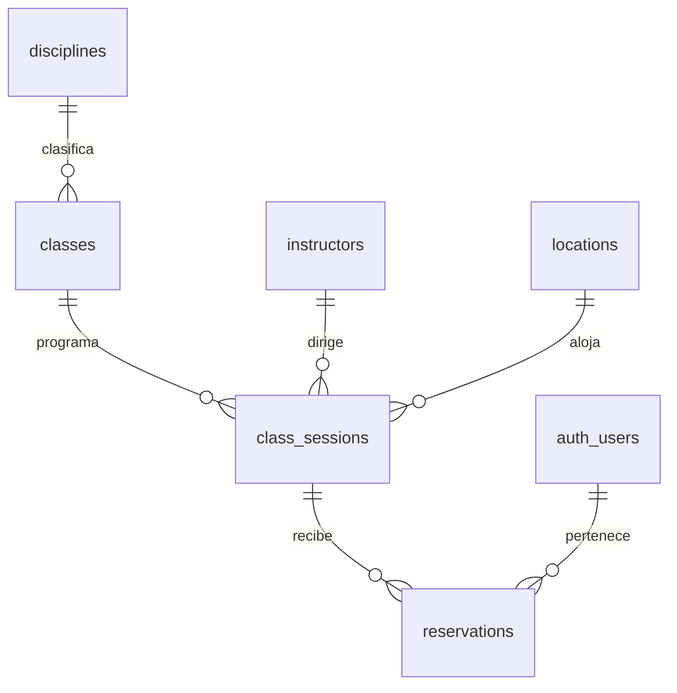
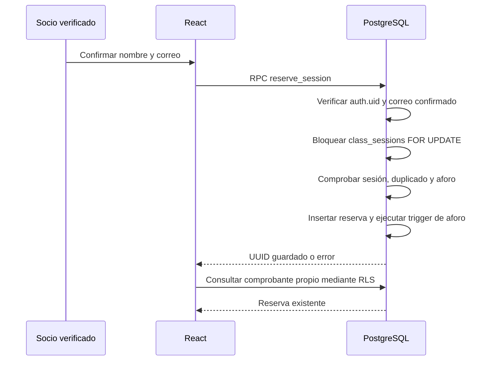

# Arquitectura

## Capas y responsabilidades

- `src/app`: composición de proveedores y layout. TanStack Query administra consultas; AuthProvider escucha Supabase Auth y elimina de caché las reservas privadas cuando cambia la identidad.
- `src/routes` y `src/pages`: seis rutas cargadas de forma diferida. Detalle y reserva operan con IDs de sesión.
- `src/components/ui`: botones, inputs y estados accesibles.
- `src/components/layout`: navegación móvil, foco, pie de página y navegación de teclado.
- `src/components/classes`: tarjetas, disponibilidad y ocupación reutilizables.
- `src/components/reservations`: formulario Zod/RHF, resumen y acceso por enlace mágico.
- `src/features`: consultas y RPC de clases y reservas; las vistas no contienen catálogos ficticios.
- `src/lib`, `src/schemas`, `src/types`, `src/utils`: cliente Supabase, traducción de errores, validación, contratos y fechas de Lima.
- `supabase`: migración versionada, seed y plantilla de correo.
- `tests`: pruebas unitarias, PostgreSQL real y navegador.

Atomic Design se aplica mediante elementos básicos (Button/Input), agrupaciones (AvailabilityBadge/OccupancyBar) y componentes de dominio (ClassCard/ReservationForm). No hay una jerarquía de abstracciones para cada fragmento de HTML.

## Modelo de datos

Todas las entidades poseen UUID y timestamps `created_at`/`updated_at`. La fecha de la sesión es `timestamptz`; la presentación usa America/Lima. Los estados admitidos son confirmed/cancelled/attended. La cancelación y el registro de asistencia no tienen interfaz ni permisos de escritura en este MVP.

La capacidad pertenece a la sesión. La disponibilidad es `capacity - count(reservations activas)` y no un contador editable del navegador. Se cuentan confirmed y attended; cancelled no ocupa lugar. Índices parciales cubren el conteo y la unicidad por socio/sesión; la consulta de reservas tiene índice por propietario y fecha. La política RLS usa `(select auth.uid()) = user_id` para evitar evaluaciones repetidas por fila.

## Reserva atómica

El bloqueo permanece hasta commit/rollback de la operación. Dos transacciones de la misma sesión se serializan. El índice único parcial es una defensa adicional frente a duplicados. Un trigger también protege importaciones administrativas; otro impide reducir el aforo por debajo de las reservas existentes. La transacción solo hace trabajo SQL, sin esperar correos ni llamadas externas.

Las funciones privilegiadas viven en `private`, con `search_path=''`, referencias cualificadas y permisos EXECUTE explícitos. Las RPC públicas son SECURITY INVOKER. `private.reserve_session` comprueba el usuario contra `auth.users`, exige correo confirmado, rechaza usuarios anónimos y no acepta un user_id del frontend. `private.list_sessions` es una excepción pública deliberada: solo devuelve catálogo y conteos agregados, nunca nombres/correos de reservas. `private` no debe añadirse a los schemas expuestos en Data API.

RLS está habilitado en las seis tablas. Los roles públicos solo leen catálogo. authenticated puede leer sus propias reservas y llamar a la RPC; no puede insertar, editar, borrar ni cancelar filas directamente. La clave pública depende de esas políticas y permisos, no del ocultamiento de endpoints.

## Flujo de identidad

Se solicita un enlace al correo mediante signInWithOtp, con flowType PKCE y redirección exacta `/auth/confirm`. Se intercambia el código una sola vez con exchangeCodeForSession y se valida la identidad con getUser. El verificador queda en el mismo navegador; no se comparte el enlace. Se limpia la URL y se limita el retorno a rutas internas autorizadas. El correo del formulario es el de la identidad verificada y es de solo lectura. Conocer un correo o UUID no permite acceder a reservas de otra cuenta. AuthProvider limpia la caché privada al cambiar de identidad. Supabase comprueba el JWT en el servicio; la función verifica además que el usuario y su correo confirmado existan.

La plantilla de enlace utiliza `{{ .ConfirmationURL }}`; en el proyecto gratuito se mantiene la predeterminada. No hay un selector que permita adoptar la identidad de otro socio. No se envía un comprobante por correo tras reservar: la pantalla entrega el código guardado y no promete servicios de notificación pendientes. El correo predeterminado se limita al equipo autorizado; el registro público de socios requiere SMTP propio.

También se admite signInWithPassword, con verificación getUser. Una cuenta confirmada puede configurar su propia contraseña mediante updateUser desde Mis reservas. No se pasa un user_id editable ni se cambia email; el servidor conserva el UUID. La contraseña solo transita entre formulario y Supabase Auth, no se persiste en caché/localStorage/tablas públicas. Formulario de alta de contraseña: 12–128 caracteres y confirmación; login acepta contraseñas existentes sin recortarlas. No se implementó registro público por password ni recuperación como funcionalidades terminadas; ver `ACCESO_CONTRASENA.md`.

## Diseño y accesibilidad

Referencias Figma consultadas: logo `1:2`; inicio `1:11`; catálogo `1:367`; detalle `1:758`; formulario `1:1017`; confirmación `1:1226`; reservas `1:1426`.

Se conservan Oswald, Space Grotesk, colores solicitados, hero centrado, fotografías originales, tarjetas de ocupación, formulario de dos columnas y comprobante central. Hay adaptaciones a 768 y 390 px, menú móvil, botones táctiles, estados vacíos, enlaces semánticos, foco visible, labels y errores asociados mediante aria-describedby. Las fotografías cargan diferidas cuando corresponde y las fuentes están empaquetadas localmente.

Los iconos se implementan con Lucide según el stack solicitado. Se retiraron de las pantallas los controles de simulación del diseño y promesas no implementadas: QR de acceso, cancelación automática, recordatorios y cancelación gratuita. El comprobante utiliza un código UUID único real. Los horarios, sedes y métricas de sesiones proceden de la base; no se afirma que las métricas estáticas de Figma sean datos reales del gimnasio.

Las instrucciones de Supabase orientaron la separación de funciones privilegiadas, RLS e índices; las de Figma orientaron la extracción de originales y adaptación al layout responsive.

## Límites actuales

El catálogo se refresca cada 15 segundos y al volver a la ventana; después de reservar se invalida la caché. La validación definitiva siempre es SQL. No se habilitó Realtime ni se necesita para la seguridad de aforo. El historial muestra sesiones pasadas sin inventar asistencia. No hay panel administrativo, pagos ni gestión de membresías.

Las pruebas locales usan PostgreSQL 17.6 real con una superficie auth mínima creada exclusivamente en el clúster de pruebas. El puente REST es infraestructura de tests y no es Supabase/PostgREST completo. Además, se conectó el proyecto alojado `cyufnolnnwaeacnyzpfy`, se verificó PostgREST real y se ejecutaron advisors y comprobaciones SQL bajo RLS. El enlace mágico está implementado y configurado; su recepción real sigue pendiente. Para socios externos se necesita SMTP; ver `docs/SUPABASE.md`.

Referencias técnicas verificadas: [Supabase RLS](https://supabase.com/docs/guides/database/postgres/row-level-security), [funciones PostgreSQL](https://supabase.com/docs/guides/database/functions), [OTP por correo](https://supabase.com/docs/guides/auth/auth-email-passwordless), [Tailwind con Vite](https://tailwindcss.com/docs/installation/using-vite), [Vite](https://vite.dev/guide/).
