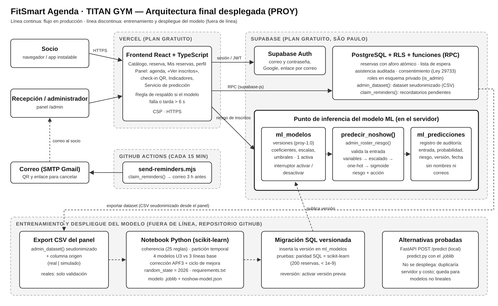

# Proyecto Final · versión integrada (proy-1.0)

FitSmart Agenda para TITAN GYM con el modelo de no-show **servido por el backend** y operando dentro del flujo de recepción. Este documento resume la arquitectura final, el estado real, cómo desplegar y cómo presentar la demo.

## Arquitectura final

Fuente editable: [arquitectura/arquitectura_final.svg](arquitectura/arquitectura_final.svg).

| Pieza | Arquitectura preliminar (APF1/APF2) | Arquitectura final | Motivo del cambio |
| --- | --- | --- | --- |
| Frontend | Aplicación web React | React + TypeScript en Vercel (plan gratuito), instalable como app | Sin cambio de fondo; se sumaron panel, QR, lista de espera y perfil. |
| Backend | API propia (FastAPI) | Supabase: PostgreSQL con RLS y funciones RPC | Las reglas críticas (aforo atómico, consentimiento, roles) viven en la base de datos; no hay servidor que mantener y el costo es S/ 0. |
| Punto de inferencia ML | Servicio Python con scikit-learn | Función `predecir_noshow()` en Supabase con el modelo exportado (`private.ml_modelos`) y registro en `private.ml_predicciones` | La regresión logística se evalúa con sus coeficientes: no necesita runtime de Python. FastAPI queda probado en local para modelos no lineales. |
| Notificaciones | WhatsApp manual | Correo automático 3 h antes (GitHub Actions + SMTP); confirmación por WhatsApp para riesgo alto | Envío sin costo y medible (`recordatorio_enviado`). |
| Datos para ML | Contrato de datos preliminar | `admin_dataset()` seudonimizado + columna `origen` | Seudonimización (Ley N.° 29733) y trazabilidad real/simulado. |

## Estado real

| Componente | Estado hoy | Pendiente o limitación |
| --- | --- | --- |
| Reservas, aforo, cancelación, lista de espera, QR y recordatorios | En producción (Vercel + Supabase) | — |
| Riesgo de no-show en «Ver inscritos» | Calculado en el servidor (proy-1.0), con registro y regla de respaldo | **Aplicar la migración `20261125000000_inferencia_servidor.sql` en Supabase** antes de la demo. |
| Servicio de predicción (Indicadores) | Estado, prueba de predicción, interruptor y registro | — |
| Modelo | proy-1.0 entrenado con datos 100 % simulados | Validar con al menos 30 registros reales (`ml/data/export_mvp_real.csv`). |
| Análisis histórico «¿Acierta el riesgo?» | Se calcula en el navegador con el mismo modelo exportado | Es análisis, no decisión; el modelo que actúa en el flujo es el del servidor. |
| Validación con TITAN GYM | Pendiente | Acta, captura fechada o video de uso del personal. |

## Despliegue

1. **Supabase → SQL Editor:** ejecutar `supabase/migrations/20261125000000_inferencia_servidor.sql` (crea las tablas del modelo, las funciones y carga la versión proy-1.0 activa). Si la migración `20261113000000_modelo_noshow_roster.sql` no está aplicada, aplicarla antes.
2. **Vercel:** se despliega solo al actualizar `main`.
3. **Comprobación:** iniciar sesión como administrador → Indicadores → Servicio de predicción debe decir **Activo · proy-1.0**; «Calcular riesgo en el servidor» devuelve un resultado y aparece en «Últimas predicciones registradas».

Para publicar una versión nueva del modelo: volver a ejecutar el notebook, crear una migración que inserte la nueva fila en `private.ml_modelos` con `activo = true` (desactivando la anterior) y mantener la prueba de paridad. Para revertir: `update private.ml_modelos set activo = (version = '<versión anterior>');`.

**Disponibilidad durante la evaluación:** Vercel y Supabase en plan gratuito; la tarea `supabase-keepalive` evita que Supabase pause el proyecto por inactividad. El modelo no depende de la red del expositor: corre en Supabase. Plan B: capturas en `docs/evidencias/` y video de respaldo.

## Guion de la demo (5 minutos)

1. **Acción principal:** con una cuenta de socio, reservar una clase (el sistema valida aforo y consentimiento).
2. **El sistema captura el dato:** la reserva queda en PostgreSQL (se ve en «Mis reservas» y en el panel).
3. **Predicción en el servidor:** como administrador, Agenda → la clase → «Ver inscritos». El servidor arma la entrada con los datos de la reserva, aplica el pipeline y devuelve el riesgo; la tabla lo muestra ordenado y explica qué hacer (confirmar por WhatsApp al riesgo alto).
4. **Registro consultable:** Indicadores → Servicio de predicción → «Últimas predicciones registradas» muestra esas predicciones con versión y fecha.
5. **Caso de error manejado:** en «Probar una predicción», escribir 99 en «Faltas sin avisar anteriores» → el servidor responde «inasistencias_previas debe estar entre 0 y reservas_previas» y no registra nada.
6. **Servicio caído (degradación controlada):** «Desactivar modelo» → volver a «Ver inscritos» → aviso «Servicio de predicción no disponible» y riesgo por reglas. Reactivar al terminar.

Los mismos pasos están automatizados en `tests/e2e/admin-panel.spec.ts` (prueba «servicio de predicción»).

## Evidencia técnica

| Requisito de la consigna | Evidencia |
| --- | --- |
| Llamada real al modelo servido por el backend | `predecir_noshow()` / `admin_roster_riesgo()`; registro en `private.ml_predicciones`. |
| Cada predicción con entrada, salida, probabilidad, versión y fecha | Tabla `private.ml_predicciones`; pantalla Indicadores → Servicio de predicción. |
| Persistencia en base de datos real | Supabase PostgreSQL. |
| Validaciones y degradación | Mensajes `ENTRADA_INVALIDA`; regla de respaldo con aviso; prueba e2e. |
| Paridad del modelo servido | `tests/integration/database.mjs`: SQL frente a scikit-learn en 200 reservas (< 1e-9). |
| Reproducibilidad | Notebook sin errores en entorno limpio, `random_state = 2026`, `ml/requirements.txt`. |
